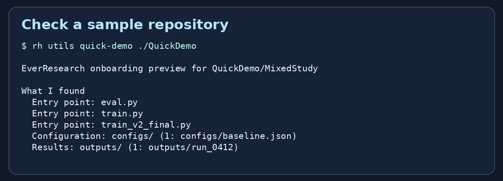
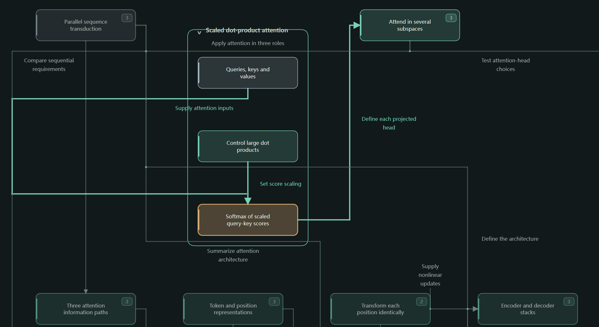

[English](README.md) · 中文

# EverResearch

EverResearch 让你现有的 AI 代理能维护科研项目。它帮助你弄清数据、模型、配置和代码怎样配合，把每次实验的配置与结果连在一起，并用项目自己的命令复现已有结果。你的代码、数据和计算环境可以继续照常使用。

## 看一遍实际操作



安装后运行 `rh utils quick-demo ./QuickDemo`。命令会生成一个示例仓库，先给出整理计划，再在另一个已整理的示例里跑两次实验。第二次直接用第一次留下的配置，最后对比两次的指标。示例使用合成数据，只需要 Python。

[](https://atheavenma.github.io/ExtractStructure/examples/attention-is-all-you-need-paper-structure.html)

打开截图可以浏览[交互论文结构图](https://atheavenma.github.io/ExtractStructure/examples/attention-is-all-you-need-paper-structure.html)，查看模型各部分的关系。结构图也适用于代码仓库。

<a id="install"></a>

## 快速开始

**终端。** 在 Python 3.11、3.12 或 3.13 环境下从 PyPI 安装 EverResearch，然后运行演示。

```sh
uv tool install ever-research
rh doctor
rh utils quick-demo ./QuickDemo
```

**Codex。** 安装插件后，打开自己的科研项目。

```sh
codex plugin marketplace add OpenSAE/EverResearch
codex plugin add ever-research@ever-research
```

**其他代理。** 在项目目录用 [Skills CLI](https://skills.sh/opensae/everresearch) 安装通用技能。

```sh
npx --yes skills add https://github.com/OpenSAE/EverResearch/tree/main/plugins/agent-plugin --all -y
```

<details>
<summary><b>各平台的安装说明及其他安装方式</b></summary>

| 平台 | 安装说明 |
| --- | --- |
| Codex | [Codex 插件](plugins/codex-plugin/) |
| Claude Code、Cowork 和网页版 | [Claude 插件](plugins/claude-plugin/) |
| Cursor | [Cursor 插件](plugins/cursor-plugin/) |
| Copilot CLI、Qwen Code | [通用代理插件](plugins/agent-plugin/) |
| Gemini CLI | [Gemini 扩展](plugins/gemini-extension/) |
| DeepSeek Harness | [DeepSeek 插件](plugins/deepseek/) |
| OpenCode | [OpenCode 插件](plugins/opencode/) |
| OpenClaw | [OpenClaw 插件](plugins/openclaw/) |
| 其他代理和终端 | [通用代理插件](plugins/agent-plugin/) · [Python 和 npm 安装](plugins/installer/) |

可在 [GitHub Releases](https://github.com/OpenSAE/EverResearch/releases/latest) 下载安装包、npm 安装器和离线插件 ZIP。使用最新源码时，在源码目录运行 `python -m pip install .`。

从 GitHub 安装的技能会在首次使用时下载、校验并缓存固定版本的运行工具。离线插件 ZIP 已包含运行工具。代理要执行命令，需要能访问项目文件、Python 和项目所需依赖。

</details>

## 三个常用场景

| 想做到什么 | 可以这样问代理 | 你会得到什么 |
| --- | --- | --- |
| 接入现有项目 | “看看仓库里的入口、数据、配置和结果。给我具体的整理方案和验证步骤，等我确认再修改。” | 现有路径、新路径、应保留的运行命令和验证方法。 |
| 加一个数据集或模型 | “把这个数据集或模型接进现有训练流程，告诉我用什么配置选中它，并用原有训练入口验证。” | 可复用的组件、选择它的配置，以及验证结果。 |
| 复现和比较实验 | “用记录下来的配置复现基线。另存一次运行，并对比两次的参数和指标。” | 一份新实验记录，以及能追溯到配置的结果对比。 |

运行 `rh projects project check ./MyProject --onboarding` 可以生成只读报告，报告里附有可直接贴给代理的指令。项目配置好维护入口后，只要还有目录结构需要调整，默认检查就会继续显示接入进度。在脚本和持续集成中，使用 `--strict` 通过退出码判断校验结果，或用 `--json` 同时获取机器可读的结果。

准备整理现有项目时，先保存基线并建一个分支。让代理保留原有入口命令、数据和结果，确认文件改动后再执行，删除文件需单独确认。合并前对照改动，并用原有命令验证。想撤回时，原分支仍保留着整理前的状态。

## 科研工作怎么用

- **运行之前**检查本次配置，并执行项目原有的预检。
- **运行之后**跟实验结果一起保存实际生效的配置，再用 `rh projects experiment check ./MyProject` 检查记录。
- **每周回顾**请代理找出最近的实验，说明你关注的指标在哪份配置下最好。
- **投稿之前**用保存的配置复现关键结果，逐项核对输出。

[完整技能库](.agents/skills/)覆盖项目、代码、数据集、模型、任务、配置、实验和知识维护，也支持 GitHub 发布和 Hugging Face 数据集与 Space 操作。

## 已整理的项目

| 项目 | 研究方向 |
| --- | --- |
| [CUB-200](src/harness/projects/templates/cub/) | 细粒度图像分类 |
| [Depth Anything 3](src/harness/projects/templates/depth_anything_3/) | 深度估计 |
| [FastVLM](src/harness/projects/templates/fastvlm/) | 高效视觉语言推理 |
| [FlagEmbedding](src/harness/projects/templates/flag_embedding/) | 文本向量与检索 |
| [LightEval](src/harness/projects/templates/light_eval/) | 语言模型评估 |
| [LLMLingua](src/harness/projects/templates/llmlingua/) | 提示词压缩 |
| [RF-DETR](src/harness/projects/templates/rf_detr/) | 目标检测 |
| [SAM2](src/harness/projects/templates/sam2/) | 图像和视频分割 |
| [VGGT](src/harness/projects/templates/vggt/) | 三维视觉几何 |

完整训练示例 BirdStudy 可从 [GitHub Releases](https://github.com/OpenSAE/EverResearch/releases/latest) 下载。[英文 README 的 SAM2 对比](README.md#research-projects)展示了上游和整理后的目录用途。

## 接下来

我们会改进实验设置和结果的并排对比，收集更多真实仓库来改善接入报告，并持续验证各代理的安装路径。欢迎在 [GitHub Issues](https://github.com/OpenSAE/EverResearch/issues)分享实验室里最想解决的问题。

[项目维护指南](src/harness/projects/README.md) · [贡献说明](CONTRIBUTING.md) · [更新记录](CHANGELOG.md) · [引用信息](CITATION.cff) · [许可证](LICENSE)
