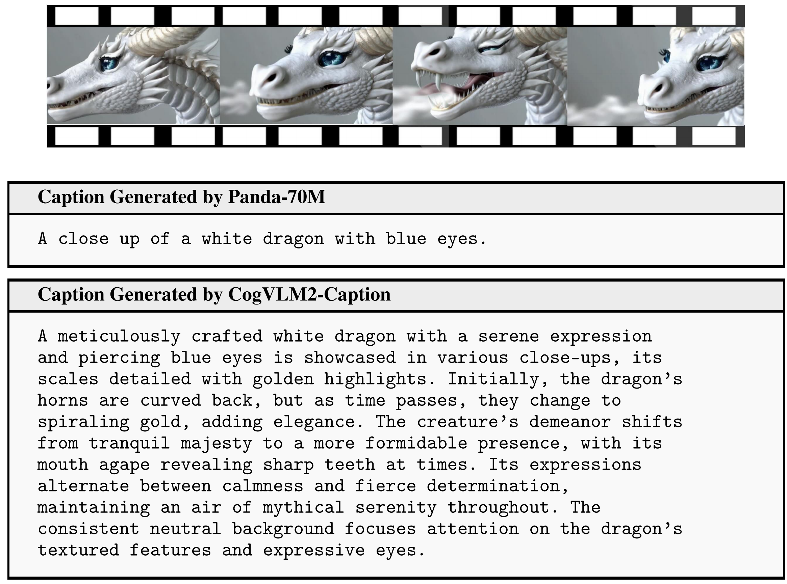
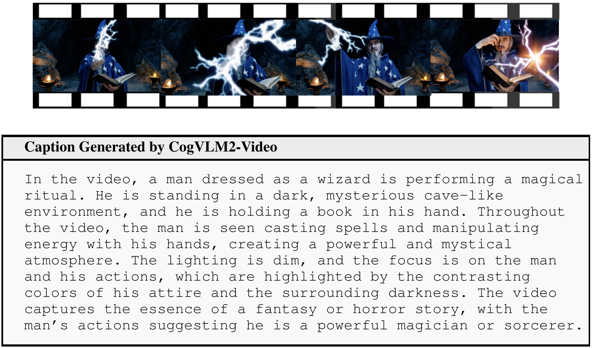

# Video Caption

Typically, most video data does not come with corresponding descriptive text, so it is necessary to convert the video
data into textual descriptions to provide the essential training data for text-to-video models.

## Update and News
- 🔥🔥 **News**: ```2024/9/19```: The caption model used in the CogVideoX training process to convert video data into text
  descriptions, [CogVLM2-Caption](https://huggingface.co/THUDM/cogvlm2-llama3-caption), is now open-source. Feel
  free to download and use it.


## Video Caption via CogVLM2-Caption

🤗 [Hugging Face](https://huggingface.co/THUDM/cogvlm2-llama3-caption) | 🤖 [ModelScope](https://modelscope.cn/models/ZhipuAI/cogvlm2-llama3-caption/)

CogVLM2-Caption is a video captioning model used to generate training data for the CogVideoX model.

### Install
```shell
python -m pip install -r requirements_caption.txt
```

### Usage

```shell
python scripts/caption/video_caption.py
```

Example:
<div align="center">
    
</div>

## Video Caption via CogVLM2-Video

[Code](https://github.com/THUDM/CogVLM2/tree/main/video_demo) | 🤗 [Hugging Face](https://huggingface.co/THUDM/cogvlm2-video-llama3-chat) | 🤖 [ModelScope](https://modelscope.cn/models/ZhipuAI/cogvlm2-video-llama3-chat) | 📑 [Blog](https://cogvlm2-video.github.io/) ｜ [💬 Online Demo](http://cogvlm2-online.cogviewai.cn:7868/)

CogVLM2-Video is a versatile video understanding model equipped with timestamp-based question answering capabilities.
Users can input prompts such as `Please describe this video in detail.` to the model to obtain a detailed video caption:
<div align="center">
    <a href="https://cogvlm2-video.github.io/"></a>
</div>

Users can use the provided [code](https://github.com/THUDM/CogVLM2/tree/main/video_demo) to load the model or configure a RESTful API to generate video captions.

## Citation

🌟 If you find our work helpful, please leave us a star and cite our paper.

CogVLM2-Caption:
```
@article{yang2024cogvideox,
  title={CogVideoX: Text-to-Video Diffusion Models with An Expert Transformer},
  author={Yang, Zhuoyi and Teng, Jiayan and Zheng, Wendi and Ding, Ming and Huang, Shiyu and Xu, Jiazheng and Yang, Yuanming and Hong, Wenyi and Zhang, Xiaohan and Feng, Guanyu and others},
  journal={arXiv preprint arXiv:2408.06072},
  year={2024}
}
```
CogVLM2-Video:
```
@article{hong2024cogvlm2,
  title={CogVLM2: Visual Language Models for Image and Video Understanding},
  author={Hong, Wenyi and Wang, Weihan and Ding, Ming and Yu, Wenmeng and Lv, Qingsong and Wang, Yan and Cheng, Yean and Huang, Shiyu and Ji, Junhui and Xue, Zhao and others},
  journal={arXiv preprint arXiv:2408.16500},
  year={2024}
}
```
