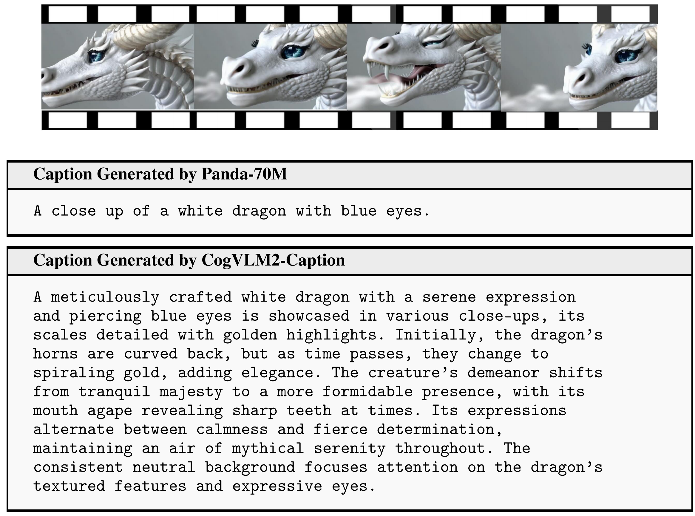
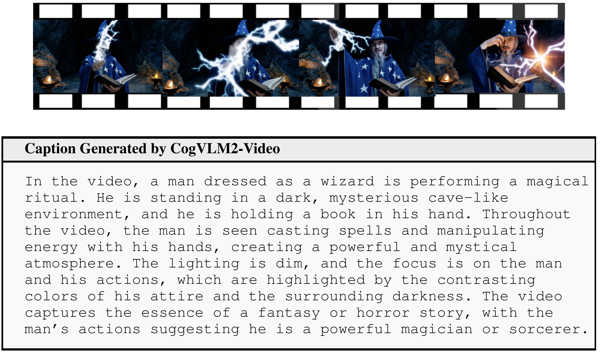

# ビデオキャプション

通常、ほとんどのビデオデータには対応する説明文が付いていないため、ビデオデータをテキストの説明に変換して、テキストからビデオへのモデルに必要なトレーニングデータを提供する必要があります。

## 更新とニュース
- 🔥🔥 **ニュース**: ```2024/9/19```：CogVideoX
  のトレーニングプロセスで、ビデオデータをテキストに変換するためのキャプションモデル [CogVLM2-Caption](https://huggingface.co/THUDM/cogvlm2-llama3-caption)
  がオープンソース化されました。ぜひダウンロードしてご利用ください。
## CogVLM2-Captionによるビデオキャプション

🤗 [Hugging Face](https://huggingface.co/THUDM/cogvlm2-llama3-caption) | 🤖 [ModelScope](https://modelscope.cn/models/ZhipuAI/cogvlm2-llama3-caption/)

CogVLM2-Captionは、CogVideoXモデルのトレーニングデータを生成するために使用されるビデオキャプションモデルです。

### インストール
```shell
python -m pip install -r requirements_caption.txt
```

### 使用方法
```shell
python scripts/caption/video_caption.py
```

例:
<div align="center">
    
</div>


## CogVLM2-Video を使用したビデオキャプション

[Code](https://github.com/THUDM/CogVLM2/tree/main/video_demo) | 🤗 [Hugging Face](https://huggingface.co/THUDM/cogvlm2-video-llama3-chat) | 🤖 [ModelScope](https://modelscope.cn/models/ZhipuAI/cogvlm2-video-llama3-chat) | 📑 [Blog](https://cogvlm2-video.github.io/) ｜ [💬 Online Demo](http://cogvlm2-online.cogviewai.cn:7868/)


CogVLM2-Video は、タイムスタンプベースの質問応答機能を備えた多機能なビデオ理解モデルです。ユーザーは `このビデオを詳細に説明してください。` などのプロンプトをモデルに入力して、詳細なビデオキャプションを取得できます：
<div align="center">
    <a href="https://cogvlm2-video.github.io/"></a>
</div>

ユーザーは提供された[コード](https://github.com/THUDM/CogVLM2/tree/main/video_demo)を使用してモデルをロードするか、RESTful API を構成してビデオキャプションを生成できます。

## Citation

🌟 If you find our work helpful, please leave us a star and cite our paper.

CogVLM2-Caption:
```
@article{yang2024cogvideox,
  title={CogVideoX: Text-to-Video Diffusion Models with An Expert Transformer},
  author={Yang, Zhuoyi and Teng, Jiayan and Zheng, Wendi and Ding, Ming and Huang, Shiyu and Xu, Jiazheng and Yang, Yuanming and Hong, Wenyi and Zhang, Xiaohan and Feng, Guanyu and others},
  journal={arXiv preprint arXiv:2408.06072},
  year={2024}
}
```
CogVLM2-Video:
```
@article{hong2024cogvlm2,
  title={CogVLM2: Visual Language Models for Image and Video Understanding},
  author={Hong, Wenyi and Wang, Weihan and Ding, Ming and Yu, Wenmeng and Lv, Qingsong and Wang, Yan and Cheng, Yean and Huang, Shiyu and Ji, Junhui and Xue, Zhao and others},
  journal={arXiv preprint arXiv:2408.16500},
  year={2024}
}
```
