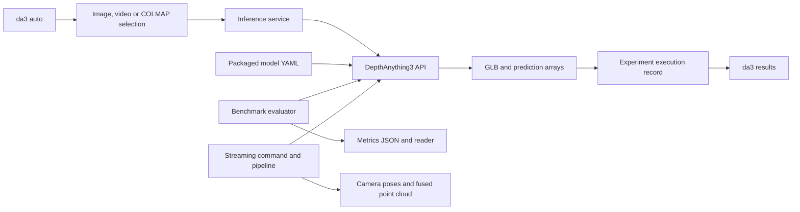

# Depth Anything 3 project guide

## Purpose and main functions

This guide maps the project’s installation, inference, evaluation, and output paths to their source
files. It also describes how to preview a local inference experiment and read its saved executions.

## Scope

Use this guide to maintain the source checkout, run the installed command, or interpret local
inference and benchmark outputs.

## Installation and entry points

Install the checkout with `pip install -e .`. The `da3` console command and
`python -m depth_anything_3.cli` use the same Typer application. Run benchmark evaluation with
`python -m depth_anything_3.bench.evaluator`. Install the `app` extra for the Gradio interface and the
`gs` extra for Gaussian rendering. The streaming pipeline has its own requirements and SALAD
submodule. [Command line](commands.md) · [Python API](interface.md) · [Benchmark](benchmark.md) ·
[Streaming](streaming.md)

## Source layout



| Path | Responsibility and consumer |
| --- | --- |
| `base/depth_anything/` | Provides the CLI, Python interface, configuration loader, runtime records and optional user interfaces. |
| `datasets/media/` | Selects images, video frames and COLMAP views and prepares image tensors. |
| `datasets/benchmark/` | Supplies the six benchmark dataset readers and their camera and reconstruction inputs. |
| `models/model/`, `models/backbone/` | Construct the selected Depth Anything model and implement its network, backbone, heads and loop detection. |
| `tasks/inference/` | Runs depth estimation through the model and exports predictions. |
| `tasks/evaluation/` | Scores camera pose and reconstruction and reads benchmark metrics. |
| `tasks/streaming/` | Runs chunking, alignment and point cloud fusion for long sequences. |
| `tasks/precheck/` | Checks prediction input and output compatibility, benchmark sources and streaming configuration. |
| `conf/` | Holds CLI defaults and the model, benchmark and streaming recipes. |
| `assets/` | Store example inputs, README figures and original SOH run evidence. |
| `doc/` | Provides CLI, API, benchmark, streaming and environment documentation. |
| `scripts/`, `third_party/salad/` | Hold the inference notebook, streaming tools and upstream loop detection dependency. |
| `tests/` | Covers CLI configuration, input selection, output generation and manifest readback. |
| `experiment/` | Holds named inference executions and their prediction artifacts. |

The public package remains `depth_anything_3`. Its module paths are preserved
for the Python API, CLI, model targets in YAML, and benchmark evaluation.
Run streaming with `python -m depth_anything_3.streaming` or `da3-streaming`
in a fresh installation.

## Inference configuration and outputs

The first CLI example in the README uses automatic input selection. The command defaults to
`depth-anything/DA3NESTED-GIANT-LARGE-1.1`, CUDA, a processing resolution of 504, and GLB export.
Options passed on the command line override those defaults. The Python constructor’s independent
`model_name` option selects an architecture and defaults to `da3-large`. The inference service
passes the CLI's checkpoint path or Hugging Face model ID to `from_pretrained`.

```bash
da3 auto assets/examples/soh/files --experiment scene_geometry --show-config
da3 auto assets/examples/soh/files --experiment scene_geometry
da3 auto assets/examples/soh/files --experiment scene_geometry --export-format npz-glb
da3 results experiment/soh/da3nested_giant_large_1_1/inference/scene_geometry
```

The preview prints the resolved experiment directory and effective options. The image-directory
handler selects regular image files in lexicographic path order. For video, sampling applies the
requested frames per second to the video’s native frame rate. COLMAP input also provides aligned
lists of camera extrinsics and intrinsics. Paths supplied to the command resolve from its working
directory. An editable installation places named results under the checkout’s `experiment/`.
With a wheel installation, invoke the command from the workspace where those results belong.

The experiment path uses the input name, model name, task and experiment purpose. Each repeat
creates `executions/<execution_id>/` inside that experiment. `da3 results` returns the manifests
in start-time order. Open the listed `config.json` and artifact paths relative to the execution
directory. The configuration records the original input and selected image order. A successful
NPZ export retains the array order, with one depth array per selected image. `mini_npz` contains
depth and the optional confidence, extrinsic and intrinsic arrays. `npz` also contains the
processed images, so its rows can be checked against the recorded input order. Use `npz-glb`
to save the prediction arrays before exporting the interactive scene.
The nested model samples pixels when estimating depth scale and the sky depth limit. Repeated
executions preserve their own predictions and can produce slightly different depth scales.

The existing `--export-dir` workflow uses the requested destination and the existing cleanup
prompt, with `workspace/gallery/scene` under the checkout as its default when available.
Backend inference writes to its gallery and reports a task ID. Gradio stores sessions and
examples under its own workspace and gallery.
Streaming writes camera poses, intrinsics and fused point clouds to its selected `--output_dir`,
and defaults to `exps/` under the checkout when available. The streaming command's `--show-config`
prints the selected recipe and paths before loading its compute dependencies.

## Benchmark data and results

The benchmark uses `conf/tasks/evaluation/config.yaml` from the installed package. Select an alternate
file with `--config` and override its values with `KEY=VALUE`. Inspection with `--show-config`
prints the merged YAML before initializing datasets or loading weights. The default model is
`depth-anything/DA3-GIANT`. The six dataset identifiers map to ETH3D, 7Scenes, ScanNet++, HiRoom,
DTU-49 and DTU-64. Input data follows the documented `workspace/benchmark_dataset` tree.
DTU-64 supplies pose evaluation. The benchmark seed fixes frame subsampling for scenes above
`eval.max_frames`. [Benchmark dataset and metrics guide](benchmark.md)

The evaluator stores scene predictions under `model_results/<dataset>/<scene>/<posed-or-unposed>`
and metric JSON under `metric_results/` inside `workspace.work_dir`. Set `eval.print_only=true`
with the original `workspace.work_dir` to read those metric files independently of the input
datasets. The standalone `depth_anything_3.bench.print_metrics` module also reads a
`metric_results` directory directly. [Benchmark commands](benchmark.md)
