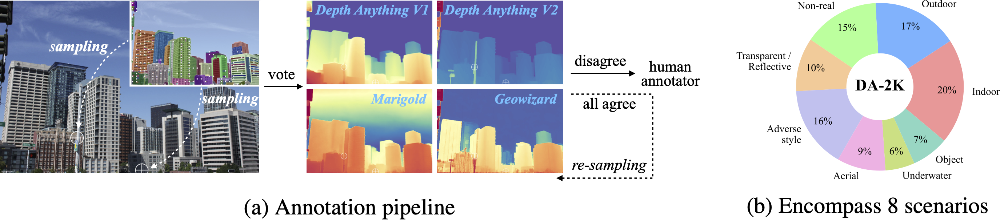

# DA-2K Evaluation Benchmark

## Purpose and main function

Identify the DA-2K benchmark and the paired image and depth inputs used for metric training.

## Scope of application

Use this guide to locate the upstream benchmark, interpret its annotations, and prepare local split lists for training and validation.

## Introduction



DA-2K is proposed in [Depth Anything V2](https://depth-anything-v2.github.io) to evaluate the relative depth estimation capability. It encompasses eight representative scenarios of `indoor`, `outdoor`, `non_real`, `transparent_reflective`, `adverse_style`, `aerial`, `underwater`, and `object`. It consists of 1K diverse high-quality images and 2K precise pair-wise relative depth annotations.

Please refer to our [paper](https://arxiv.org/abs/2406.09414) for details in constructing this benchmark.


## Usage

Please first [download the benchmark](https://huggingface.co/datasets/depth-anything/DA-2K/tree/main).

All annotations are stored in `annotations.json`. The annotation file is a JSON object where each key is the path to an image file, and the value is a list of annotations associated with that image. Each annotation describes two points and identifies which point is closer to the camera. The structure is detailed below:

```
{
  "image_path": [
    {
      "point1": [h1, w1], # (vertical position, horizontal position)
      "point2": [h2, w2], # (vertical position, horizontal position)
      "closer_point": "point1" # we always set "point1" as the closer one
    },
    ...
  ],
  ...
}
```

The published benchmark includes `visualize.py`. Run it from the downloaded benchmark to visualize the annotations:
```bash
python visualize.py [--scene-type <type>]
```

**Options**
- `--scene-type <type>` (optional): Specify the scene type (`indoor`, `outdoor`, `non_real`, `transparent_reflective`, `adverse_style`, `aerial`, `underwater`, and `object`). Skip this argument or set <type> as `""` to include all scene types.

The project's [formal run choices](maintenance.md#formal-run-choices) give the separate pairwise scoring command, its 100-image timing sample, and the estimated time for the full publisher dataset. The [DA-2K reader](../datasets/da_benchmark/dataset.py) loads source annotations and images, and the [pairwise task](../tasks/pairwise_depth/evaluate.py) scores the model's depth ordering.

## Metric training inputs

The training command accepts `--train-split` and `--validation-split`, each a text file with one image and depth path pair per line. Use paths available to the training process. The Hypersim reader expects HDF5 distance maps with a `dataset` entry. With `--dataset vkitti`, training reads Virtual KITTI 2 depth images in centimeters and validation reads KITTI depth images encoded with a factor of 256. The original split lists are retained in [assets/splits](../assets/splits) for sample selection; their paths refer to upstream mounts.

## Citation

If you find this benchmark useful, please consider citing:

```bibtex
@article{depth_anything_v2,
  title={Depth Anything V2},
  author={Yang, Lihe and Kang, Bingyi and Huang, Zilong and Zhao, Zhen and Xu, Xiaogang and Feng, Jiashi and Zhao, Hengshuang},
  journal={arXiv:2406.09414},
  year={2024}
}
```
