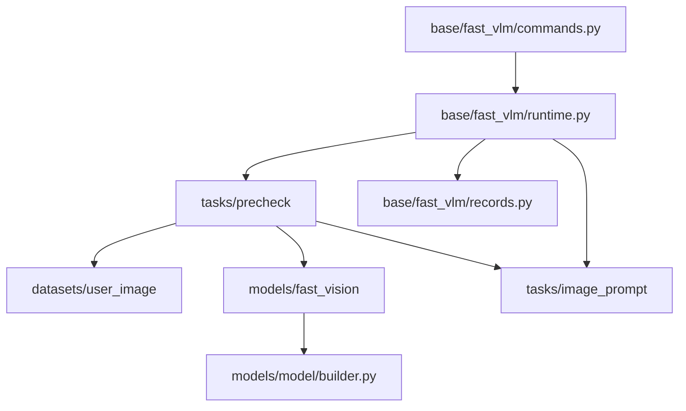

# FastVLM code and interfaces

The checkout command `python main.py` and the installed command `fastvlm` call the same parser and runtime. Use `--show-config` to inspect values and `--read-result` to inspect a prediction.

Setuptools maps the source directories to the established `fastvlm`, `llava` and `model_export` import names. The Apple application retains Apple's Xcode project and camera layout. [Package mapping](../../pyproject.toml) [Xcode demo](../../third_party/apple_demo/README.md) [Export](apple_silicon/README.md)
