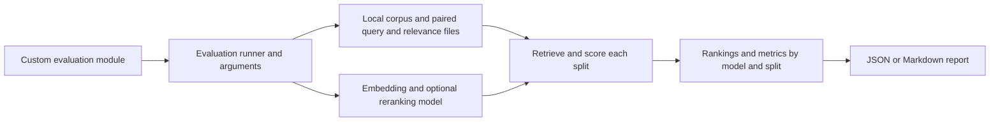

# FlagEmbedding repository structure

## Purpose and main functions

This page shows where to start for inference, fine-tuning, and retrieval evaluation, and where the corresponding model, dataset, and result code lives.

## Scope

Use this guide to work on the installable FlagEmbedding package, its examples and tests, or a research reproduction package in this checkout. The original research recipes and published API use the public paths listed here.

## Checkout layout

| Path | Responsibility and callers |
| --- | --- |
| [base/flag_embedding](../../base/flag_embedding/) | Public inference APIs, evaluation and training entry support, and shared runtime interfaces. [Setuptools](../../setup.py) maps these files and the component directories to the established `FlagEmbedding` package. |
| [datasets](../../datasets/) | Benchmark corpus, query, and judgment loaders plus training example preparation and collators. |
| [models](../../models/) | Embedding and reranking model families and architectures for inference and fine-tuning. |
| [tasks](../../tasks/) | Evaluation and fine-tuning commands, retrieval execution and metrics, and prechecks. |
| [conf](../../conf/config.json) | Defaults consumed by the shared evaluation arguments and distributed with the installed package. |
| [examples](../../scripts/examples/README.md) | `inference/` demonstrates the Python API. `fine_tuning/` and `evaluation/` hold caller-facing shell recipes with model, data, and output arguments. |
| [Training datasets](../datasets.md) | Training dataset catalogue. Model and training instructions link to original data sources. |
| [Sphinx documentation](model_documentation/README.md) | Sphinx sources in `source/` and build instructions. `source/API/` follows public Python imports, `source/bge/` covers model series, and `source/tutorial/` contains published tutorial content. `Introduction/`, `FAQ/`, `community/`, and `_static/` serve the published site. |
| [Tutorial notebooks](../../scripts/tutorials/README.md) | Executable notebooks from embeddings and metrics through indexing, evaluation, reranking, retrieval-augmented generation, and fine-tuning. The tutorial index lists the learning sequence. |
| [scripts](../../scripts/README.md) | Standalone data operations. `hn_mine.py` and `hn_mine_nv.py` mine negatives using different inference backends, `add_reranker_score.py` scores examples for distillation, and `split_data_by_length.py` prepares data for fine-tuning. |
| [tests](../../tests/README.md) | Local software checks at the top level. `integration/` exercises public checkpoints and tokenizers. Pytest discovers both from the root. |
| [Upstream research releases](../../third_party/README.md) | Self-contained paper implementations, reproduction recipes, benchmark examples, and release archives. Some have their own dependency and install declarations. |
| `experiment/` | Local results from the [BEIR launcher](../../scripts/examples/evaluation/beir_benchmark/evaluate.sh), the [custom experiment example](../../scripts/examples/evaluation/custom/eval_custom.sh), and the Quick Start acceptance run below. The directory is created on the first run and ignored by Git. |
| [`tasks/precheck/`](../../tasks/precheck/) | Bounded local retrieval checks packaged as `FlagEmbedding.precheck` and invoked by the custom evaluation command. |
| [project illustrations](../../assets/illustrations/project/README.md) and [.github/workflows](../../.github/workflows/) | Root README images and documentation build workflow. |
| `AGENTS.md` and `.agents/skills/` | Local EverResearch entry and shared skills for an enrolled checkout. |
| `README.md`, `doc/knowledge/readme_chinese.md`, `setup.py`, and `LICENSE` | Project navigation, package installation and distribution, and license. |

## Public workflows and their source paths

| Workflow | Entry point and responsible code | Data and outputs |
| --- | --- | --- |
| Embedding | `FlagAutoModel.from_finetuned` dispatches through [embedding/model_mapping.py](../../models/embedding/model_mapping.py). Encoder-only implementations include the base encoder and M3. Decoder-only implementations include base, in-context learning, and pseudo mixture of experts. | Use a published model identifier or local weight directory. `encode_queries`, `encode_corpus`, and `encode` return features. M3 can also return sparse and multi-vector features. |
| Reranking | `FlagAutoReranker.from_finetuned` uses [ranking/model_mapping.py](../../models/ranking/model_mapping.py). Encoder-only, decoder-only, layerwise, and lightweight implementations score query-document pairs. | `compute_score` returns scores for the supplied pairs. The model class determines applicable options such as cutoff and compression layers. |
| Fine-tuning | `python -m FlagEmbedding.finetune.<embedder-or-reranker>.<architecture>.<variant>` loads the dataclass arguments through Hugging Face Transformers. The [embedder recipes](../../scripts/examples/fine_tuning/embedding/README.md) and [reranker recipes](../../scripts/examples/fine_tuning/ranking/README.md) document the seven entry points. | The selected variant consumes training data through the dataset classes in `abc/finetune/` and its own variant directory. The training output directory contains checkpoints and saved model/tokenizer files. `--output_dir` and `--resume_from_checkpoint` control writing and resuming. |
| Evaluation | `python -m FlagEmbedding.evaluation.<benchmark>` starts MTEB, BEIR, MSMARCO, MIRACL, MLDR, MKQA, AIR-Bench, BRIGHT, or custom evaluation. See the [evaluation recipes](../../scripts/examples/evaluation/README.md). | Benchmark adapters select data and the appropriate evaluation protocol. Standard retrieval evaluation writes ranked documents by query and split, with an optional second stage for the reranker. The report summarizes metrics from the persisted rankings. |

The `base/flag_embedding/interfaces/` families hold reusable data contracts, model and trainer interfaces, and evaluation orchestration. `base/flag_embedding/compatibility/` handles compatibility with Transformers across those families. Model mappings and the `encoder_only` and `decoder_only` branches are part of the established package structure used by examples and API documentation. Benchmark-specific loaders own dataset names, split selection, and source-specific download and parsing. MTEB and AIR-Bench use their benchmark libraries. BEIR, BRIGHT, and MKQA also implement benchmark-specific behaviors such as query instructions, document handling, or answer-based metrics.

The [shared evaluator](../../tasks/retrieval/evaluator/__init__.py) writes and reuses retrieval and reranking results for each split, then computes metrics from the saved rankings. The [BEIR evaluator](../../tasks/evaluation/beir_benchmark/evaluator.py) delegates those stages to the shared implementation and retains CQA sub-dataset names, cache paths, ranking metadata, and aggregate metrics. With an embedding cache enabled, `cqadupstack/android` and `cqadupstack/english` each write their own `doc.npy` under the model and dataset directories. Existing ranking files keep their names and fields. A changed `--k_values` recomputes the report from saved rankings. Retrieval depth is controlled separately by `--search_top_k` and `--rerank_top_k`.

The [BRIGHT runner](../../tasks/evaluation/bright/runner.py) resolves the requested splits and supplies each split's own relevance judgments. The [BRIGHT retriever](../../tasks/evaluation/bright/searcher.py) applies the benchmark exclusions to candidates from the [shared dense searcher](../../tasks/retrieval/searcher/__init__.py), which owns encoding, embedding cache reads and writes, and FAISS search. Each ranking retains the existing `<dataset>-<split>.json` path.

The [MTEB runner](../../tasks/evaluation/mteb_benchmark/runner.py) sets each task's instructions and few-shot examples before handing it to the benchmark. Missing task files use the embedder's default examples. The runner forwards `--overwrite` to MTEB's saved-result handling and aggregates the task scores from disk.

## Local custom evaluation

Install `.[evaluation]` from the checkout for CPU FAISS and relevance evaluation. Supply a local dataset directory and either a published model name or a local model path. The [custom dataset recipe](../../scripts/examples/evaluation/README.md#9-custom-dataset) gives the JSONL fields and both launch modes. The shell recipe uses the checkout's `experiment/<dataset>/<model>/retrieval/<experiment>/` for results. An experiment name uses one to three lowercase words separated by underscores, such as `dense_retrieval`. The `python -m` entry continues to accept relative or absolute paths for `--output_dir` and `--eval_output_path`.

Use `--dataset_names` to select members of a collection and `--splits` to select paired query and relevance files. Defaults select all named members and the `test` split. A ranking file stores query identifiers, document identifiers and scores, plus the dataset and split identity. The `EVAL/eval_results.json` file next to the rankings contains per-split metrics. The combined JSON report groups those metrics by embedder and reranker. Reuse the same recipe to read existing rankings and pass `--overwrite True` to recompute for a changed input or run condition. Use a distinct experiment name for a different condition whose rankings you want to retain.

## Research and published asset paths

Research packages keep the source and assets needed by the corresponding paper or release. `BGE_Coder`, `BGE_Reasoner`, `LLARA`, `Reinforced_IR`, `llm_dense_retriever`, and `llm_embedder` cover specialized or general-purpose retrieval. `BGE_M3`, `baai_general_embedding`, `reranker`, `llm_reranker`, and `Matroyshka_reranker` cover model releases or ranking methods. `BGE_VL`, `BGE_VL_Screenshot`, and `visual_bge` cover visual retrieval. `C_MTEB` and `MLVU` hold evaluation packages. `Long_LLM` and `LM_Cocktail` contain separate research programs. `old-examples` retains paths cited by previous releases, including the BGE pretraining example. Each research package keeps its own documented commands and result locations.

The recursively inventoried directories with more than ten maintained files use these boundaries.

| Directories | Disposition and caller |
| --- | --- |
| `assets/benchmark_examples/embedding_benchmark/files/` (57) and `third_party/flag_embedding_research/llm_dense_retriever/examples/bge-en-icl/MTEB/` (56) | Keep the published CSV reference and the corresponding JSON few-shot examples. `--examples_path` reads the JSON collection by MTEB task name. |
| `assets/benchmark_examples/air_bench/files/long_document/` (15) and `third_party/flag_embedding_research/llm_dense_retriever/examples/bge-en-icl/AIR-Bench/long-doc/` (15) | Keep the published AIR-Bench examples under the document collection names used by each release. |
| `scripts/examples/inference/embedding/decoder_only/` and `scripts/examples/inference/ranking/decoder_only/` | Launchers live under `automatic/` and `direct/`, with six presets in each. Their filenames and example output remain the same. Encoding and scoring use [the embedding demo](../../scripts/examples/inference/embedding/decoder_only/demos/embedding.py) and [the ranking demo](../../scripts/examples/inference/ranking/decoder_only/demos/ranking.py). |
| `third_party/flag_embedding_research/BGE_Coder/evaluation/coderag_eval/test/create/` (12) | Preserve the source-specific benchmark builders and their shared `utils.py`. `repoeval` and `swebench` each have separate whole-repository and benchmark record preparation. |
| `third_party/flag_embedding_research/BGE_VL/assets/corpus/` (11) | Keep the visual example corpus with the reproduction package that documents it. |
| `third_party/flag_embedding_research/Long_LLM/longllm_qlora/main/` (11) and `third_party/flag_embedding_research/Long_LLM/activation_beacon/main/` (15) | Keep the published training and benchmark commands. Each project has its own `src` implementation and trainer. Within each project the InfBench and LongBench scripts use their benchmark-specific utilities and share the local model setup. |
| `third_party/flag_embedding_research/llm_embedder/evaluation/` (11) | Keep the separate downstream tasks and the shared `eval_retrieval` entry used by the tool, QA, conversation, and in-context learning workflows. |
| `third_party/flag_embedding_research/visual_bge/visual_bge/eva_clip/` (18) | Keep the EVA-CLIP model, tokenizer, transforms, and training support in the package imported by the visual retrieval release. |
| `.agents/skills/` | Keep enrolled skill links at their discovery locations. |

## Maintenance checks

| Area | Where it was traced and what was checked |
| --- | --- |
| Runtime | Traced `HfArgumentParser` through `AbsEvalRunner`, model construction, and aggregation. The shared evaluator runs both ranking phases for ordinary and CQA BEIR datasets. BRIGHT keeps its short and long loader selection and now delegates dense search to the shared implementation. |
| Datasets | Traced `corpus.jsonl`, `<split>_queries.jsonl`, and `<split>_qrels.jsonl` through the custom, BEIR, and BRIGHT local loaders. Generated data covered named collections, missing-split rejection before model loading, independent CQA member caches, and split-specific BRIGHT document exclusions. |
| Models | Traced the inference factories to model mappings and weight readers. Generated BERT encoder and sequence classifier checkpoints exercised those factories and CPU inference through the public evaluation entry points. |
| Tasks | In custom evaluation, two splits with the same query ID ranked their corresponding documents first. In BEIR, the ordinary dataset and two CQA members each wrote their expected document IDs and produced Recall@1 of 1.0 for retrieval and reranking. The BRIGHT regression starts with two retrieved documents and verifies that each split keeps its own relevant document and reports Recall@1 of 1.0. The original runner kept the first split's document in both rankings. A local MTEB benchmark double exercised the public command for two tasks and wrote score files consumed by the regular report reader. |
| Parameters | Changing `--k_values` from 1 to 2 now computes Recall@2 from the same stored rankings. The regression blocks retrieval to verify reuse. The MTEB regression checks that `--examples_path` hands the model the selected task's examples, that the following task uses its defaults, and that `--overwrite True` reaches MTEB. |
| Experiments | Verified result readback in both workflows. The BEIR test reuses all ranking files with retrieval and reranking blocked and checks the combined JSON report. A [local archive](../../assets/history_experiment/synthetic_retrieval/README.md) preserves a prior generated custom run. |
| Scripts, tests, and documentation | `tests/test_retrieval_evaluation.py` and `tests/test_mteb_evaluation.py` cover the local commands. Tests in `tests/integration/` exercise public checkpoint and tokenizer resources. The evaluation guide documents the dependency extra, ranking depths, few-shot example files, and refreshing rankings from earlier runs. The decoder-only inference guides link to the shared demonstrations. |

The project root collected 26 pytest cases, including eight checkpoint and tokenizer integration cases. With Hugging Face offline, the local suite passed all 18 cases on Transformers 5.23.0 and passed 17 cases on Transformers 4.57.6 with one version-specific skip. The encoder fine-tuning `--help` command exposed the model, training data, output, and checkpoint arguments. A wheel built from `setup.py` and ran the library's embedding and similarity workflow outside the source directory with generated BERT weights. The public [README Quick Start](../../README.md#quick-start) uses `BAAI/bge-base-en-v1.5` and computes similarities as the inner product of two embedding batches. The local check exercised this API and verified a finite 2 × 2 score matrix with matching-sentence scores of about 1.0.

The custom and BEIR launchers resolve results under the checkout's `experiment/` when called from a separate working directory. Both reject invalid experiment names. The evaluation modules also support explicit output arguments, with relative paths resolved from the working directory.

## Quick Start real-data inference

The main README's Quick Start ran the published BGE Base English v1.5 checkpoint on 12 FiQA test queries and 46 documents. It produced 768-dimensional embeddings and a 12 × 46 similarity matrix using the documented `FlagAutoModel.encode` calls and NumPy inner product. Two independent executions, including one started outside the checkout, produced identical arrays. Reading the arrays back confirmed FiQA IDs on both axes and agreed with float64 scores recomputed from the saved embeddings to within 0.000244.

The local [Quick Start run record](../../assets/history_experiment/fiqa_similarity/README.md) contains the pinned inputs, launch commands, runtime, and output manifests. The judged documents were included in the subset to exercise end-to-end readback with original labels.

## FiQA real-data evaluation

The [BEIR launcher](../../scripts/examples/evaluation/beir_benchmark/evaluate.sh) ran its published BGE Large English v1.5 embedder and BGE Reranker v2 M3 on 12 FiQA test queries and 1,200 FiQA documents using one RTX 5090. The corpus included all documents with relevance judgments for the selected queries. Dense retrieval returned 1,000 documents per query, and the reranker rescored the top 100. Dense retrieval scored 0.75304 nDCG@10 and reranking scored 0.69571. Recall@100 was 1.0 in both stages. These figures describe the sampled corpus.

The local [run record](../../assets/history_experiment/fiqa_retrieval/README.md) contains the input revisions, commands, effective configuration, and independent metric verification. The launcher regenerated the Markdown report from saved rankings with a different Python hash seed and produced identical hashes for the embeddings, rankings, metrics, and report. This run covers the FiQA evaluation workflow. Other public benchmark workflows, training runs, and research reproductions require their own run evidence.
