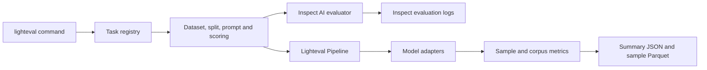

# Project structure

## Purpose and main functions

This guide maps Lighteval's commands to task definitions, dataset loading,
model backends, scoring, and result storage. It also records the checks used
when moving built-in task implementations into families.

## Scope

Use this guide to maintain the source checkout, choose the owner of a change,
or follow an evaluation from its input configuration to its saved results.

## Repository paths

| Path | Role and consumer |
| --- | --- |
| `base/evaluation/` | Console dispatcher and Python Pipeline. Packaging maps this directory and the component roots to the public `lighteval` package. |
| `base/evaluation/commands/` | CLI implementations for evaluation backends, result tools, and task tools. The installed package keeps the existing `lighteval.main_*` Python imports used by backend callers. |
| `datasets/` | Hugging Face Hub dataset loading, few-shot split selection, and length-aware batching. |
| `models/adapters/` | Model configuration and execution adapters for Transformers, GPU runtimes, and endpoints. The pipeline selects the adapter through `model_loader.py`. |
| `tasks/` | Task registration and benchmark definitions, prompt construction, sample prechecks, per-sample and corpus scoring, and the chance baseline. The registry supplies task definitions to the CLI and Python Pipeline. |
| `conf/config.yaml` | Stable study names used by the result tracker to save and reopen runs. |
| `base/evaluation/logging/` | Result and sample-detail writers and readers. The pipeline delegates to `EvaluationTracker`. Inspect AI owns its log format. |
| `base/evaluation/utilities/` | Shared runtime helpers for caching, dependencies, language and parallel execution. The model and task packages use them. |
| `doc/code/evaluation/source/` | User guides and package reference built through `_toctree.yml`. The source filenames carry the published guide URLs. |
| `scripts/examples/` | Runnable integration examples, model configurations and task templates. Model examples and Nanotron recipes are explicit inputs to their backend commands. Serbian MMLU task lists are in `assets/examples/task_lists/files/serbian_task_group/mmlu/`. |
| `assets/examples/task_lists/files/` | Text task selections read by the registry. The Quick Tour uses `open_llm_leaderboard_tasks.txt`. Lists such as `recommended_set.txt`, `all_tasks.txt`, and `bbh.txt` retain historical task IDs and require review before use with the current registry. |
| `tests/` | Unit tests, slow integration checks, and their archived results. `tests/conftest.py` controls the `--runslow` marker. |
| `.github/` | Packaging, documentation, quality checks and test workflows. |
| `assets/` | Logo referenced by the repository README. |
| `experiment/` | Default local output root created by CLI evaluations. Model-based commands group outputs by dataset, model, task selection, and study purpose. |

The root also contains the packaging entry points `pyproject.toml` and
`setup.py`, the formatting entry points
`.pre-commit-config.yaml` and `Makefile`, and the project README and license.
An attached ResearchHarness workspace supplies `AGENTS.md` and `.agents/`
as local engineering entry points.

Lighteval ships its model adapters, task definitions, and dataset loading
contract in the installable package. A task owns its source, subset, split,
sample formatter and metrics in `LightevalTaskConfig`. This keeps those
declarations together when packages are installed and lets custom tasks use
the same dataset interface. The Hub cache supplies external dataset files.
Typer options and backend configuration objects supply defaults, and
`scripts/examples/model_configs/` and `scripts/examples/nanotron_engine/` supply optional YAML
recipes. The existing documentation tree is the source for the published site.
`lighteval.egg-info/`, `.pytest_cache/` and `.ruff_cache/` are generated
by installation, testing and linting.

## Evaluation paths

The preferred command, `lighteval eval`, takes one or more Inspect model
identifiers and a task selection. The README example uses
`hf-inference-providers/openai/gpt-oss-20b` with `gpqa:diamond`. The task's
`gpqa_diamond` subset comes from `Idavidrein/gpqa`. Its declared scoring split
is `train`. The task converts each record into a question, four choices and
the target letter. Inspect runs the multiple-choice solver and aggregates
correctness. With zero demonstrations, the declared split supplies scored
items. For positive few-shot counts, Inspect first uses the configured or
inferred demonstration split. When demonstrations and scoring share a
split, Inspect removes the demonstration inputs from the scored items.

The other evaluation commands use `Pipeline`. It constructs the selected
backend or accepts an existing Python model, loads datasets through the task
objects, and calls each model with the generation or scoring requests the task
defines. `EvaluationTracker` can save a JSON summary and per-sample Parquet
files. `Pipeline.get_results()` and `Pipeline.get_details()` expose them to
Python callers. The tracker can read saved detail files for reevaluation of
tasks sharing a single request type.

Task arguments accept names, comma-separated selections, task lists, and a
`|<few-shot count>` suffix. The registry expands families such as `mmlu`.
Each backend reads the shared CLI settings from `command_arguments.py`. Python callers can still import them from `lighteval.cli_args`.
Pipeline commands and the baseline command pass their dataset worker count
to `LightevalTask.load_datasets()`. With several workers, each load receives
one task and its source, revision, and filter. The loaded datasets are
assigned to their original tasks before prompts and metrics run.
Pipeline's backend options may use example YAML or inline model settings.
Inspect's `--max-samples` passes the per-task limit to Inspect AI.
Its `--frequence-penalty`, `--log-probs`, and `--response-format` settings
set frequency penalty, token log probabilities, and an optional JSON response
schema in Inspect AI.

vLLM, SGLang, and LiteLLM recipes read model settings from `model_parameters`.
An optional `metric_options` mapping sets the number of generated responses
via `<metric name>.num_samples`. The pipeline applies this value before
constructing each task's model requests. For example, `em.num_samples` is the
count for the exact-match metric. A task with several metrics requests the
highest count they require. Inline model settings use the task's built-in
generation counts. The prediction cache distinguishes recipe overrides that
change the count, and replay checks the count recorded in each saved sample.

For evaluation logs and retries, see [the Inspect AI guide](../inspect-ai).
For Pipeline result paths and Parquet readback, see
[saving and reading results](../saving-and-reading-results).

## Built-in task families and retained layouts

- `tasks/core_benchmarks/` groups single-file tasks by what they evaluate. Academic
  exams, benchmark suites, word problems, general knowledge, reading
  comprehension, and commonsense reasoning each have a named source family.
  Multi-file benchmarks such as IFEval and LiveCodeBench keep each benchmark's
  prompts, metrics and supporting code together. Contributors publish task
  definitions through `TASKS_TABLE`.
- `tasks/multilingual_benchmarks/` groups single-language evaluations by language or
  region, and cross-language evaluations by benchmark or input type.
  `swiss_legal/` supplies the Swiss legal implementation and the existing
  `swiss_legal_evals` module exposes it. The multilingual install option supplies
  the language names used by tasks such as M3Exam.
- Built-in task families share the registry, task configuration, prompts or
  templates, and scoring interfaces. Individual files supply dataset sources,
  splits, formatting, and metrics for their particular benchmarks. Historical
  Python imports such as `lighteval.tasks.tasks.gsm8k` still resolve to the
  implementing module. The same discovery serves task registration and
  `lighteval tasks dump`.
- `base/evaluation/commands/` groups Inspect, Accelerate, Nanotron, vLLM, SGLang, custom
  models, and HTTP endpoints with the task and result tools. Each backend
  supplies its own model or runtime configuration. Commands backed by
  `Pipeline` share evaluation, display, and result saving through
  `Pipeline.evaluate_and_save()`. Inspect and the model-free baseline retain
  their own execution and result formats.
- `tests/fixtures/metric_cases/` groups JSON fixtures by metric family for
  `test_automated_metrics_pytest.py`. The slow tests' archived
  `tests/fixtures/reference_details/` trees group their model and backend outputs by evaluation family.
  Their Parquet filenames are consumed by the sample-comparison reader. The
  top-level docs retain their published local names and documentation index.

The recursive source inventory found 95 files directly in the core task
directory and 85 in the multilingual task directory. Those directories now
hold one and two direct files, respectively. Each new family contains at
most ten direct files. The Serbian task list directory went from 13 files
to seven after the MMLU lists moved into their own group.

The metric test loader discovers 47 JSON input files. The sample-comparison
reader discovers 27 original Parquet fixtures for each of the SmolLM2
Transformers and vLLM backends. The documentation site source preserves the
guide names used to build published URLs. The original study acceptance
directories, commands, logs, and outputs are preserved in the evaluation acceptance archive.

## Saved study locations

The existing GSM8K and TruthfulQA archives use these locations under
`experiment/`. The original paths in older logs and manifests identify where
the runs were recorded. Each current execution manifest maps the original task identifier to its results and response details.

| Dataset and source | Model | Task | Study path below `experiment/` |
| --- | --- | --- | --- |
| GSM8K (`openai/gsm8k`) | Meta Llama 3 8B Instruct | `gsm8k` | `grade_school_math/llama_3_8b_instruct/math_word_problems/benchmark_evaluation/` |
| TruthfulQA (`truthfulqa/truthful_qa`) | GPT-2 | `truthfulqa:mc` | `truthful_qa/gpt2_transformer/multiple_choice/answer_scoring/` and `truthful_qa/gpt2_transformer/multiple_choice/benchmark_evaluation/` |
| TruthfulQA (`truthfulqa/truthful_qa`) | Baseline from the answer choices | `truthfulqa:mc` | `truthful_qa/multiple_choice/chance_scores/` |

For a copy still stored in the previous escaped layout, Pipeline replay can
find the old path from the original dataset, model and task selection. An
explicit output root continues to use its existing model and timestamp layout.

## Maintenance evidence

| Area | Representative check and outcome |
| --- | --- |
| Runtime and entry points | Traced the installed console script through Typer, the task registry, Inspect AI, and the Pipeline commands. The built wheel contained all nine relocated command modules and matched the source checkout's CLI help. Previous Python imports resolved from the wheel. The Inspect adapter regression test exercises the regular CLI. |
| Dataset input | Verified the source, subset and split selected for `gpqa:diamond` with synthetic rows. The existing local JSON test also verifies that the Python task loader consumes its declared data file. |
| Models | Exercised generation with the Inspect mock backend and a local Pipeline test model. Transformers, vLLM, SGLang and endpoint backends retain separate model configuration classes. Nanotron's optional package was unavailable. Its legacy configuration still needs integration with the prediction cache's model configuration interface. |
| Tasks and metrics | Compared the baseline and current registry and metadata exports for 674 core tasks and 52,776 tasks with multilingual support. Task identifiers, dataset sources and subsets, prompt modules, and normalized exports matched. IFEval now requests NLTK tokenizers at the point of use. TinyBenchmarks discovery no longer downloads calibration data. Its corpus scorer reads the existing local calibration path. |
| Settings | The CLI resolves the default output from the workspace and keeps explicit paths relative to the caller. The Inspect study name is validated before a new output directory is created. A local YAML recipe changed the count sent by the Pipeline to its model and kept predictions with different counts in separate cache entries. |
| Evaluation output | Separate synthetic Inspect evaluations produced independent logs and reopened through the Inspect reader. A Pipeline test saved and replayed a matching score from Parquet. The replay tests cover the escaped study layout, mixed few-shot counts in the same study, and passthrough of the configured fsspec filesystem. The baseline CLI wrote a model-free study from one local JSON sample. |
| README local Python recipe | The published Meta Llama 3 8B Instruct checkpoint ran on CUDA in bfloat16 and answered two zero-shot GSM8K test questions. The Python API saved the default `benchmark_evaluation` study. The project reader reopened the sample details and recomputed the extractive match score of `1.0` against the original questions and reference answers. |
| Public Quick Tour recipe | Accelerate loaded the published GPT-2 weights and scored eight TruthfulQA validation examples on CUDA. The JSON summary gave MC1 `0.375` and MC2 `0.4871977812`. The CLI reopened the named study, and the eight rows matched the original evaluation, the dataset labels, and the independently recomputed scores. A direct invocation from the workspace parent also wrote to the checkout's default study. |
| README remote recipe | `lighteval eval` stopped while loading the gated `Idavidrein/gpqa` dataset. The configured Hugging Face credentials received HTTP 403, so the run did not reach `openai/gpt-oss-20b` inference. |
| Examples, tests and docs | Grouped the six Serbian MMLU task lists and updated the contributor and result guides. Existing metric and slow-test archives retain the paths used by their readers. |

The README Python example scores rows 588 and 1214 from the GSM8K `main/test`
split, using the task's fixed shuffle seed of 42. The original evaluation
acceptance archive records the weights, data revision, environment, command,
and saved-result checks. The Quick Tour study separately covers eight examples
from the TruthfulQA `multiple_choice` validation split, chosen with the same
seed. Each score describes the evaluated examples.
Inspect log handling was tested separately with synthetic input and its mock
backend. For the Quick Tour run commands, versions, and sample-level checks, open the
`acceptance/reproducibility/README.md` report for the `answer_scoring` study
inside the original evaluation acceptance archive.

Offline project-root collection found 699 checks after the study path update.
The selected software checks passed 81 tests and 133 subtests, with one remote
logging test skipped. Two automated metric cases require resources absent from
the test environment, the BLEURT checkpoint and the multilingual dependencies
for extractiveness. The previous command and result reader checks collected
697 tests.

The study migration preserved the file contents of all 55 saved files. From
the workspace parent directory, the current reader recovered two GSM8K samples
and eight TruthfulQA samples at the new paths. The TruthfulQA archive also
contains the checked explicit legacy output layout.

In the earlier task family maintenance pass, the five Inspect regression cases also passed with
the minimum supported Inspect AI version, 0.3.140. Three additional
metric-request tests require the Hugging Face XStoryCloze dataset and
could not run with Hub access disabled.

## Offline maintenance follow-up

| Area | Entry checked and result |
| --- | --- |
| Runtime and entry points | Invoked the installed `lighteval tasks --help` and `lighteval accelerate --help` from the workspace parent. Built an offline wheel, then ran `python -m lighteval tasks dump` from its extracted package. It exposed nine command modules and 100 core task module records. The existing `lighteval.main_inspect` and `lighteval.tasks.tasks.gsm8k` imports resolved from the wheel. |
| Dataset input | Ran `lighteval eval` with a custom task and local JSON data. Inspect now forwards explicitly declared files and revisions to its dataset loader. Replacing the local sample at the same path produced the updated inputs and targets in the next Inspect log. |
| Models | The local Inspect mock ran through the CLI and produced sample records. The Pipeline regression exercised a local model with one and three generations per sample and checked cache separation. |
| Tasks and metrics | Building the same few-shot Inspect task twice now keeps its configured solver list stable, so each build applies one demonstration message. At the time of this check, few-shot sample selection used the evaluation split. The archived scores cover zero-shot runs. |
| Settings | Checked Accelerate's output, study, and replay options in the installed CLI. With model loading intercepted, the Accelerate command parsed the text and vision example recipes as their respective Transformers configurations. Inspect validates study names before creating directories and accepts explicit log locations. |
| Evaluation output | From the workspace parent, read the archived JSON and reopened Parquet using `EvaluationTracker`. Recomputing the means of the saved sample scores matched the summaries. GSM8K returned two samples and extractive match `1.0`. TruthfulQA returned eight samples and MC1 `0.375` and MC2 `0.4871977812`. These are prior records. |
| Examples, tests and docs | Resolved all 28 documentation navigation entries, opened all 11 example YAML files, and rechecked the oversized directories described above. Pytest collected 701 cases at the project root. The locally runnable selection passed 318 tests and 142 subtests, with five skips. The seven Inspect tests passed after the local-file refresh check. The broader selection exposed cases that depend on absent Hub datasets, model resources, or multilingual extras. |

## Parallel dataset loading retest

| Area | Entry checked and result |
| --- | --- |
| Runtime and entry points | Followed `lighteval baseline` and the Pipeline commands from the shared CLI option to the task dataset loader. The worker pool now passes each task individually to the existing loader. The installed `lighteval tasks dump` from the workspace parent returned 100 core module records covering 674 task configurations. |
| Dataset input | The baseline CLI read two local JSON datasets with distinct answer choices. The two-process invocation previously failed because the worker received both task objects in one call. |
| Models | The focused checks use the Inspect mock model and Pipeline's local dummy model. The Accelerate CLI parsed the text and vision example files as `TransformersModelConfig` and `VLMTransformersModelConfig`, with model construction intercepted. |
| Tasks and metrics | The baseline gave the two-choice task `0.5` and the three-choice task `1/3` with either worker count. The different expected scores detect assignment of a dataset to the wrong task. |
| Settings | The existing `--dataset-loading-processes` option retains its default of one process. The regression exercises both one and two processes with the current CLI. |
| Evaluation output | The baseline wrote summaries in the explicit output layout. From the workspace parent, `EvaluationTracker` reopened two GSM8K samples and eight TruthfulQA samples by their saved timestamps. The means of the sample scores matched the JSON summaries for extractive match (`1.0`) and for MC1 (`0.375`) and MC2 (`0.4871977812`). |
| Examples, tests and docs | The Quick Tour uses a task list that resolves to 62 registered tasks. The documentation index resolves to 28 source files, and 11 example YAML files parse as mappings. Pytest collected 702 tests at the project root. |

The locally runnable selection passed 338 tests and 142 subtests, with two
skips. A broader run reported eight failed tests and six failed subtests in
checks that require uncached model or tokenizer files or the optional vLLM
dependency. This retest used local JSON fixtures and saved results.

## Inspect demonstration split retest

| Area | Entry checked and result |
| --- | --- |
| Runtime and entry points | Invoked the installed `lighteval eval --help`, `lighteval accelerate --help`, and `lighteval tasks dump` from the workspace parent. Task discovery returned 100 module records covering 674 configurations. |
| Dataset input | Synthetic GSM8K rows reproduced the old test-to-test split selection. The same regression now verifies separate evaluation and demonstration loads, including an explicitly configured demonstration split. The local JSON task loader test passed. |
| Models | The Inspect mock backend completed the GPQA task through the public CLI and logged its system and user messages. Pipeline tests exercised local dummy models. |
| Tasks and metrics | The GPQA regression previously scored both records after selecting one as a demonstration. The current Inspect log shows the demonstration in a system message and exactly one scored record with a different input. Three targeted regression cases reproduced the old split behavior. |
| Settings | Inspect and Pipeline now use the same inference rule for `hf_avail_splits`. The explicit `few_shots_split` takes precedence, and the commands keep the existing task syntax and output options. |
| Evaluation output | `EvaluationTracker` reopened two saved zero-shot GSM8K samples and eight TruthfulQA samples from the study layout, plus eight TruthfulQA samples from the explicit legacy layout. The sample means matched the archived JSON summaries for extractive match (1.0), MC1 (0.375), and MC2 (0.4871977812). |
| Examples, tests and docs | Resolved 28 documentation navigation entries and parsed 11 example YAML recipes. Rescanned the tree and confirmed the six oversized directories described above are documentation, pinned test inputs, or archived results. Project-root Pytest collection found 705 cases. |

With Hugging Face and Transformers offline, the focused logging, pipeline,
registry, and local dataset selection passed 43 tests and 133 subtests.
One Hub logging test skipped and two Hub-dependent loader cases were excluded.
Ruff lint and format checks passed for the changed Python files. The retest
used synthetic inputs and existing saved results.
